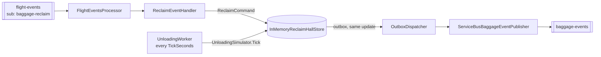

# svc-baggage-reclaim

> Puts each arriving flight's bags on a reclaim belt and reports their progress until the belt is clear.

| | |
| --- | --- |
| Repo | `aeroflow-air/svc-baggage-reclaim` |
| Owner | AeroFlow platform (Tony Joanes) |
| Status | prototype, local only |
| Runs in | aeroflow-local AppHost resource `svc-baggage-reclaim`; Container Apps later (ADR-0007) |
| Last reviewed | 2026-10-17 |

Written to the [service docs standard](https://github.com/aeroflow-air/platform-handbook/blob/main/docs/standards/service-docs.md). The airport-wide picture is in the [airport overview](https://github.com/aeroflow-air/platform-handbook/blob/main/docs/architecture/airport-overview.md). Plan: [platform-handbook#44](https://github.com/aeroflow-air/platform-handbook/issues/44).

## Purpose

Owns the **reclaim hall**: the belts, each arriving flight's reclaim (belt, bags and their state) and the `baggage-events` topic. It simulates unloading after landing and publishes each step.

It does **not** handle departing bags, does not know real passenger numbers, and its HTTP reads are anonymous; its one write — completing a reclaim — needs the `Ops.Reclaim.Write` role ([svc-baggage-reclaim#9](https://github.com/aeroflow-air/svc-baggage-reclaim/issues/9), [ADR-0018](https://github.com/aeroflow-air/platform-handbook/blob/main/docs/decisions/0018-entra-id-authentication-authorisation.md)).

## Design decisions

| Decision | Why | Link |
| --- | --- | --- |
| Pure domain: `ReclaimPlanner.Apply(hall, command)` and `UnloadingSimulator.Tick` | testable without I/O or timers | [ADR-0004](https://github.com/aeroflow-air/platform-handbook/blob/main/docs/decisions/0004-functional-style-csharp.md) |
| Owns and publishes its own topic `baggage-events` | one owner per topic | [ADR-0013](https://github.com/aeroflow-air/platform-handbook/blob/main/docs/decisions/0013-central-event-bus.md) |
| Idempotent by event id, stored in the same atomic update as the change (last 10,000) | at-least-once delivery must not assign two belts | `Messaging/ReclaimEventHandler.cs` |
| Outbox in the store plus deterministic event ids | a failed publish is retried, never lost; re-sends carry the same id | [ADR-0017](https://github.com/aeroflow-air/platform-handbook/blob/main/docs/decisions/0017-reliable-event-publishing.md), `Domain/BaggageEvent.cs` |
| Entra ID app roles, JWT validated per service; fake auth handler locally | writes are authorised without any Azure deployment or tenant | [ADR-0018](https://github.com/aeroflow-air/platform-handbook/blob/main/docs/decisions/0018-entra-id-authentication-authorisation.md), `Auth/` |
| Least busy belt with room, ties to the first listed | spreads load | `Domain/ReclaimPlanner.cs` |
| Stable bag count per flight (60-180) | the simulator sends no passenger numbers | `FlightEvents:Min/MaxBagsPerFlight` |
| Publisher is a no-op without `messaging` | runs and tests without the bus | `Program.cs` |

## Architecture

- **Domain**: `ReclaimHall` (belts, reclaims, applied event ids), commands `AssignBelt`, `RecordDelay`, `CancelReclaim`, `MoveBag`, `CompleteReclaim`; bag states `Unloaded`, `OnBelt`, `Delayed`, `Collected`, `Missing`.
- **Storage**: in memory; seven belts (`1` to `7`) of capacity two flights each.
- **Messaging**: processor (one message at a time, manual completion), handler, unloading worker, outbox dispatcher and publisher. The handler and the worker never publish directly: each hall change and the events it produced (`BeltAssigned`, tick events) are saved in **one atomic store update**, and `OutboxDispatcher` sends them in order ([ADR-0017](https://github.com/aeroflow-air/platform-handbook/blob/main/docs/decisions/0017-reliable-event-publishing.md)).

## Inputs

### HTTP API

| Method | Route | Purpose | Responses |
| --- | --- | --- | --- |
| GET | `/health` | readiness (and liveness) | 200 |
| GET | `/alive` | liveness | 200 |
| GET | `/belts` | every belt with its open and completed reclaims (stage `Assigned`, `OnBelt`, `LastBag`, `Complete`, bag counts); cancelled reclaims are left out. Read by the ops dashboard on startup ([platform-handbook#74](https://github.com/aeroflow-air/platform-handbook/issues/74)) | 200 |
| GET | `/belts/{id}` | one belt, same shape as an item of `/belts` | 200, 400 `invalid_belt`, 404 `belt_not_found` |
| GET | `/flights/{flightId}/reclaim` | a flight's reclaim in any status (`Unloading`, `Complete`, `Cancelled` with reason), stage, delay and every bag with its status | 200, 400 `invalid_flight_id`, 404 `reclaim_not_found` |
| POST | `/flights/{flightId}/reclaim/complete` | complete a reclaim: close it, mark uncollected bags missing, publish `ReclaimComplete` via the outbox. Needs role `Ops.Reclaim.Write` (ADR-0018) | 200, 400 `invalid_flight_id`, 401, 403, 404 `reclaim_not_found`, 409 `reclaim_closed` |
| GET | `/bags/{bagTag}` | one bag (case-insensitive tag) with its status, flight, belt and reclaim status; if a wrapped tag appears twice, the latest landing wins | 200, 400 `invalid_bag_tag`, 404 `bag_not_found` |
| GET | `/scalar`, `/openapi/v1.json` | API docs, only when `ApiDocs:Enabled` (true in Development) | 200 |

A copy of the generated OpenAPI document is checked in at `openapi/svc-baggage-reclaim.json` (catalogued by Backstage, ADR-0024). `OpenApiExportTests` fails when it drifts from the code; regenerate with `UPDATE_OPENAPI=1 dotnet test --filter OpenApiExportTests`.

Errors are RFC 7807 ProblemDetails (`application/problem+json`) with `code` set to the domain error code and `instance` to the path. 401/403 from authorisation are the standard empty ASP.NET Core responses, not ProblemDetails.

### Events consumed

| Topic | Subscription | Event type | Effect | Ignored |
| --- | --- | --- | --- | --- |
| `flight-events` | `baggage-reclaim` | `Landed` | `AssignBelt` with the flight's bags; publishes `BeltAssigned` | flights whose `destination` is not `HomeAirport`; already-applied event ids |
| | | `Delayed` | `RecordDelay` if the flight has a belt | otherwise ignored |
| | | `Cancelled` | `CancelReclaim`, frees the belt slot, if it has a belt | otherwise ignored |
| | | | | `Scheduled`, `Boarding`, `Departed` |

Contract: `Messaging/FlightEventMessage.cs`, a **local copy** of `AeroFlow.Local.FlightEvents.FlightEvent`.

### Configuration

| Setting | Default | Meaning |
| --- | --- | --- |
| `ApiDocs:Enabled` | `false` (`true` in Development) | serve OpenAPI and Scalar |
| `Auth:UseFake` | `false` (`true` in Development) | fake auth handler mints claims from an `Authorization: Fake <roles>` header; local/tests only, never in Production |
| `AzureAd:Instance` / `TenantId` / `ClientId` | unset | Entra app registration for JWT bearer validation; when `ClientId` is unset and fake auth is off, protected endpoints fail closed with 401 |
| `Outbox:RetrySeconds` | `5` | how often unsent baggage events are retried when nothing else wakes the dispatcher |
| `ConnectionStrings:messaging` | unset | when unset: no processor, no-op publisher |
| `FlightEvents:Topic` / `Subscription` | `flight-events` / `baggage-reclaim` | |
| `FlightEvents:HomeAirport` | `LHR` | arrivals here get a belt |
| `FlightEvents:MinBagsPerFlight` / `MaxBagsPerFlight` | 60 / 180 | |
| `Baggage:Topic` | `baggage-events` | outgoing topic |
| `Baggage:SimulateUnloading` | true | false freezes reclaims at `BeltAssigned` |
| `Baggage:TickSeconds` | 2 | |
| `Baggage:FirstBagAfterLandingSeconds` | 10 | |
| `Baggage:BagsPerTick` / `CollectedPerTick` | 12 / 10 | |
| `Baggage:DelayedBagProbability` | 0.01 | |
| `Baggage:Seed` | random | fixed for repeatable runs |

### Observability

This service consumes `AeroFlow.ServiceDefaults` 0.1.1 from the org GitHub Packages feed (`https://nuget.pkg.github.com/aeroflow-air/index.json`; see the README for the local `read:packages` PAT). Conventions are in [service-defaults.md](service-defaults.md) and [lib-service-defaults](https://github.com/aeroflow-air/lib-service-defaults). `Program` calls `AddServiceDefaults()` and `MapDefaultEndpoints()`, so `/health` and `/alive` are served in every environment. HTTP requests are logged automatically; Service Bus publish and consume paths emit platform events 2000–2003 via `IObservabilityLog`. W3C trace context on Service Bus messages is a later follow-up and is not wired here.

| Setting | Default | Meaning |
| --- | --- | --- |
| `Observability:ServiceName` | `svc-baggage-reclaim` | resource attribute `service.name` |
| `Observability:ServiceVersion` | entry assembly informational version | `service.version` |
| `Observability:Environment` | `local` | `deployment.environment` (falls back to the host environment if unset) |
| `Observability:Squad` | `platform` | `aeroflow.squad` |

#### Event catalogue

**Platform** events (category `AeroFlow.ServiceDefaults`):

| Event id | Name | Level | When |
| --- | --- | --- | --- |
| 1000 | HttpRequestCompleted | Information | Each HTTP request except `/health` and `/alive` |
| 1001 | HttpRequestFailed | Warning | The request ended in a 5xx status |
| 1002 | HttpRequestUnhandled | Error | An unhandled exception escaped the pipeline |
| 2000 | MessagePublished | Information | A Service Bus message was sent |
| 2001 | MessagePublishFailed | Error | Sending a Service Bus message failed |
| 2002 | MessageConsumed | Information | A Service Bus message was handled (`applied`, `rejected`, `ignored`, or `dead-lettered`) |
| 2003 | MessageConsumeFailed | Error | Handling a Service Bus message failed |
| 3000 | OperationFailed | Error | An unexpected failure outside a single message (processor error, unloading tick) |

**Business** events (this service, event ids at or above 10,000; domain code stays log-free):

| Event id | Level | Message | When |
| --- | --- | --- | --- |
| 10000 | Information | `Listening for flight events on {Topic}/{Subscription}` | Processor started |
| 10001 | Information | `{Command} for {FlightNumber} after {EventType}` | Flight event applied |
| 10002 | Warning | `{EventType} for {FlightNumber} rejected: {Code} {Message}` | Business rejection |
| 10003 | Debug | `{EventType} for {FlightNumber} ignored: {Reason}` | Idempotent / out-of-scope event |
| 10004 | Warning | `Dead-lettered unreadable flight event {MessageId}` | Body could not be read |
| 10005 | Warning | `Service Bus processor error ({Source})` | SDK processor error |
| 10006 | Information | `Published {EventType} for {FlightNumber} on belt {Belt}` | Baggage event sent to `baggage-events` |
| 10007 | Warning | `Publishing baggage events failed; {Pending} pending in the outbox, retrying in {RetrySeconds}s` | Transient publish failure |
| 10008 | Error | `Permanent failure publishing baggage events ({Reason}); {Pending} pending in the outbox are blocked behind it` | Non-transient publish failure |
| 10009 | Warning | `Final drain of baggage events at shutdown failed` | Last drain threw |
| 10010 | Warning | `Stopping with {Pending} baggage events still in the outbox; they are lost with the in-memory state` | Unsent events at shutdown |
| 10011 | Warning | `Baggage unloading tick failed; will retry next tick` | Unloading simulator tick threw |

## Outputs

### Events published

Topic `baggage-events`. Body `BaggageEvent` (JSON, web casing, nulls omitted): `eventId`, `eventType`, `flightId`, `flightNumber`, `belt`, `occurredAt` plus the fields below. `MessageId` = event id, `Subject` = event type, `CorrelationId` = flight id. Event ids are deterministic (UUIDv5), so a re-send has the same `MessageId`; delivery is **at least once** and consumers de-duplicate by `eventId`.

| Event type | When | Extra fields |
| --- | --- | --- |
| `BeltAssigned` | `Landed` applied (event id derived from the `Landed` event's id and the type) | |
| `BagsOnBelt` | first bag reaches the belt (~10 s after landing, plus any delay) | `bagCount` |
| `BagDelayed` | a bag misses the flight (1%) | `bagTag`, `reason` |
| `LastBagOnBelt` | hold empty | |
| `ReclaimComplete` | belt empty, or an authorised `POST .../reclaim/complete` (same deterministic event id either way); uncollected or delayed bags become missing | `bagCount`, `bagsCollected`, `bagsMissing` |

A 120-bag flight goes from `Landed` to `ReclaimComplete` in about 35 seconds. Today only the `ops-dashboard` subscription exists, and nothing reads it yet (#53).

### Other side effects

In-memory hall; logs `Published {EventType} for {FlightNumber} on belt {Belt}`.

## Dependencies

| Dependency | Needed for | Behaviour when absent |
| --- | --- | --- |
| Service Bus (`messaging`), `flight-events` / `baggage-reclaim`, topic `baggage-events` | consuming and publishing | no processing; publisher is a no-op |
| flight-simulator | `Landed` events for LHR arrivals | hall stays empty |
| Microsoft Entra ID | JWT validation for write endpoints, only when `AzureAd:ClientId` is set | reads still work; writes return 401. Locally replaced by the fake auth handler (`Auth:UseFake`) |

## Failure modes

| Failure | How it shows up | Impact | What to do |
| --- | --- | --- | --- |
| All belts full (7 x 2 flights) | warning `Landed for XX123 rejected: no_belt_available` | that flight's bags never appear | expected under load; slows as reclaims complete |
| Redelivered flight event | debug `ignored` | none (idempotent) | none |
| `Delayed`/`Cancelled` for a flight without a belt | debug `ignored` | none | normal: most delays happen before landing |
| Unreadable or empty body | warning `Dead-lettered unreadable flight event`; dead-letter queue grows | event lost | contract copy drifted (#71) |
| Publish to `baggage-events` fails (`BeltAssigned` or tick events) | warning `Publishing baggage events failed; N pending in the outbox, retrying in 5s` | events wait in the outbox, in order, and are re-sent after each `Outbox:RetrySeconds` back-off (new changes don't shorten it); the hall keeps moving | check the emulator; a growing pending count means the bus is still down |
| Send succeeded but reported failure (timeout) | same warning, then a second `Published ...` | sent twice with the same `MessageId`; duplicate detection on `baggage-events` (turned on in the aeroflow-local AppHost, [aeroflow-local#11](https://github.com/aeroflow-air/aeroflow-local/pull/11); Standard tier in Azure) and consumers de-duplicating by `eventId` drop the copy | none |
| Bus unreachable for consuming | warning `Service Bus processor error` | no new reclaims | check the emulator |
| `baggage-events` subscription not read | message count grows in the Aspire dashboard | none until a reader exists | expected until #53 |
| Publish fails permanently (message too large, unauthorised, topic missing) | error `Permanent failure publishing baggage events (Reason); N pending in the outbox are blocked behind it` | sending is strictly in order with no attempt limit, so this event and **everything behind it** stay queued and the in-memory outbox grows until it is fixed or the process restarts | fix the cause (usually the topic or permissions); poison handling and a size cap are tracked in [platform-handbook#108](https://github.com/aeroflow-air/platform-handbook/issues/108) |
| Shutdown or deploy | warning `Final drain of baggage events at shutdown failed`, then `Stopping with N baggage events still in the outbox`, only if some couldn't be sent | the dispatcher stops after the message processor and makes one last drain within the shutdown timeout, so a routine deploy normally loses nothing | if the warning appears, the bus was down at shutdown |
| Process restart | hall empty, applied ids forgotten | in-flight reclaims and unsent outbox events lost; no completion events | expected; a durable store must keep the outbox in the same transaction (ADR-0017) |

## Running and testing

- Standalone: `dotnet run --project src/AeroFlow.BaggageReclaim`, then `curl http://localhost:8080/health`. Nothing else happens without the bus.
- With the airport: clone next to `aeroflow-local` (the AppHost will not build otherwise) and run its AppHost. Healthy logs after an LHR landing: `AssignBelt for U21234 after Landed`, `Published BeltAssigned ...`, then `BagsOnBelt`, `LastBagOnBelt`, `ReclaimComplete` over ~30 s. Use `Baggage__TickSeconds=1` to speed up.
- Tests: `dotnet test` covers the planner, unloading simulator, event handler (including idempotency), deterministic ids, the outbox (failed publish, retry, ordering), publishing, the read API and the reclaim-complete endpoint (authorised, 401 and 403 cases, ProblemDetails errors, the outbox event, and the OpenAPI document), health, `/alive`, and the observability contract.

## Known gaps

- No reader for `baggage-events` ([#53](https://github.com/aeroflow-air/platform-handbook/issues/53)). Reads are still anonymous — gating them with Entra roles is undecided (ADR-0018).
- Event contracts are local copies, and `BaggageEvent` lives only here ([#71](https://github.com/aeroflow-air/platform-handbook/issues/71)).
- `workload.yaml` cannot declare the subscription or the topic ([#64](https://github.com/aeroflow-air/platform-handbook/issues/64)).
- In-memory state (hall and outbox); authentication is Entra ID in production shape but no tenant exists yet, so only the fake handler has run (ADR-0018).
- The outbox has no size limit and no poison handling: an event that can never be sent (for example too large) holds back everything behind it, and a long outage grows memory. Acceptable for the demo; tracked in [platform-handbook#108](https://github.com/aeroflow-air/platform-handbook/issues/108).
