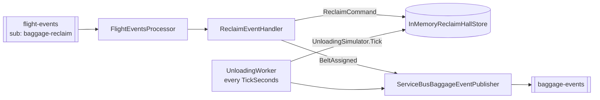

# svc-baggage-reclaim

> Puts each arriving flight's bags on a reclaim belt and reports their progress until the belt is clear.

| | |
| --- | --- |
| Repo | `aeroflow-air/svc-baggage-reclaim` |
| Owner | AeroFlow platform (Tony Joanes) |
| Status | prototype, local only |
| Runs in | aeroflow-local AppHost resource `svc-baggage-reclaim`; Container Apps later (ADR-0007) |
| Last reviewed | 2026-10-14 |

Written to the [service docs standard](https://github.com/aeroflow-air/platform-handbook/blob/main/docs/standards/service-docs.md). The airport-wide picture is in the [airport overview](https://github.com/aeroflow-air/platform-handbook/blob/main/docs/architecture/airport-overview.md). Plan: [platform-handbook#44](https://github.com/aeroflow-air/platform-handbook/issues/44).

## Purpose

Owns the **reclaim hall**: the belts, each arriving flight's reclaim (belt, bags and their state) and the `baggage-events` topic. It simulates unloading after landing and publishes each step.

It does **not** handle departing bags, does not know real passenger numbers, and only has a read-only belts list so far; the rest of the query API is [platform-handbook#69](https://github.com/aeroflow-air/platform-handbook/issues/69).

## Design decisions

| Decision | Why | Link |
| --- | --- | --- |
| Pure domain: `ReclaimPlanner.Apply(hall, command)` and `UnloadingSimulator.Tick` | testable without I/O or timers | [ADR-0004](https://github.com/aeroflow-air/platform-handbook/blob/main/docs/decisions/0004-functional-style-csharp.md) |
| Owns and publishes its own topic `baggage-events` | one owner per topic | [ADR-0013](https://github.com/aeroflow-air/platform-handbook/blob/main/docs/decisions/0013-central-event-bus.md) |
| Idempotent by event id, stored in the same atomic update as the change (last 10,000) | at-least-once delivery must not assign two belts | `Messaging/ReclaimEventHandler.cs` |
| `BeltAssigned` reuses the `Landed` event's id | consumers can de-duplicate across redelivery | `Domain/BaggageEvent.cs` |
| Least busy belt with room, ties to the first listed | spreads load | `Domain/ReclaimPlanner.cs` |
| Stable bag count per flight (60-180) | the simulator sends no passenger numbers | `FlightEvents:Min/MaxBagsPerFlight` |
| Publisher is a no-op without `messaging` | runs and tests without the bus | `Program.cs` |

## Architecture

- **Domain**: `ReclaimHall` (belts, reclaims, applied event ids), commands `AssignBelt`, `RecordDelay`, `CancelReclaim`, `MoveBag`, `CompleteReclaim`; bag states `Unloaded`, `OnBelt`, `Delayed`, `Collected`, `Missing`.
- **Storage**: in memory; seven belts (`1` to `7`) of capacity two flights each.
- **Messaging**: processor (one message at a time, manual completion), handler, unloading worker and publisher.

## Inputs

### HTTP API

| Method | Route | Purpose | Responses |
| --- | --- | --- | --- |
| GET | `/health` | liveness | 200 |
| GET | `/belts` | every belt with its open and completed reclaims (stage `Assigned`, `OnBelt`, `LastBag`, `Complete`, bag counts); cancelled reclaims are left out. Read by the ops dashboard on startup ([platform-handbook#74](https://github.com/aeroflow-air/platform-handbook/issues/74)) | 200 |

The rest of the belts, reclaim and bag API (one belt, a flight's reclaim, bags, completing a reclaim) is [platform-handbook#69](https://github.com/aeroflow-air/platform-handbook/issues/69).

### Events consumed

| Topic | Subscription | Event type | Effect | Ignored |
| --- | --- | --- | --- | --- |
| `flight-events` | `baggage-reclaim` | `Landed` | `AssignBelt` with the flight's bags; publishes `BeltAssigned` | flights whose `destination` is not `HomeAirport`; already-applied event ids |
| | | `Delayed` | `RecordDelay` if the flight has a belt | otherwise ignored |
| | | `Cancelled` | `CancelReclaim`, frees the belt slot, if it has a belt | otherwise ignored |
| | | | | `Scheduled`, `Boarding`, `Departed` |

Contract: `Messaging/FlightEventMessage.cs`, a **local copy** of `AeroFlow.Local.FlightEvents.FlightEvent`.

### Configuration

| Setting | Default | Meaning |
| --- | --- | --- |
| `ConnectionStrings:messaging` | unset | when unset: no processor, no-op publisher |
| `FlightEvents:Topic` / `Subscription` | `flight-events` / `baggage-reclaim` | |
| `FlightEvents:HomeAirport` | `LHR` | arrivals here get a belt |
| `FlightEvents:MinBagsPerFlight` / `MaxBagsPerFlight` | 60 / 180 | |
| `Baggage:Topic` | `baggage-events` | outgoing topic |
| `Baggage:SimulateUnloading` | true | false freezes reclaims at `BeltAssigned` |
| `Baggage:TickSeconds` | 2 | |
| `Baggage:FirstBagAfterLandingSeconds` | 10 | |
| `Baggage:BagsPerTick` / `CollectedPerTick` | 12 / 10 | |
| `Baggage:DelayedBagProbability` | 0.01 | |
| `Baggage:Seed` | random | fixed for repeatable runs |

## Outputs

### Events published

Topic `baggage-events`. Body `BaggageEvent` (JSON, web casing, nulls omitted): `eventId`, `eventType`, `flightId`, `flightNumber`, `belt`, `occurredAt` plus the fields below. `MessageId` = event id, `Subject` = event type, `CorrelationId` = flight id.

| Event type | When | Extra fields |
| --- | --- | --- |
| `BeltAssigned` | `Landed` applied (event id = the `Landed` event's id) | |
| `BagsOnBelt` | first bag reaches the belt (~10 s after landing, plus any delay) | `bagCount` |
| `BagDelayed` | a bag misses the flight (1%) | `bagTag`, `reason` |
| `LastBagOnBelt` | hold empty | |
| `ReclaimComplete` | belt empty; uncollected or delayed bags become missing | `bagCount`, `bagsCollected`, `bagsMissing` |

A 120-bag flight goes from `Landed` to `ReclaimComplete` in about 35 seconds. Today only the `ops-dashboard` subscription exists, and nothing reads it yet (#53).

### Other side effects

In-memory hall; logs `Published {EventType} for {FlightNumber} on belt {Belt}`.

## Dependencies

| Dependency | Needed for | Behaviour when absent |
| --- | --- | --- |
| Service Bus (`messaging`), `flight-events` / `baggage-reclaim`, topic `baggage-events` | consuming and publishing | no processing; publisher is a no-op |
| flight-simulator | `Landed` events for LHR arrivals | hall stays empty |
| Keycloak (`identity`) | referenced by the AppHost | not used |

## Failure modes

| Failure | How it shows up | Impact | What to do |
| --- | --- | --- | --- |
| All belts full (7 x 2 flights) | warning `Landed for XX123 rejected: no_belt_available` | that flight's bags never appear | expected under load; slows as reclaims complete |
| Redelivered flight event | debug `ignored` | none (idempotent) | none |
| `Delayed`/`Cancelled` for a flight without a belt | debug `ignored` | none | normal: most delays happen before landing |
| Unreadable or empty body | warning `Dead-lettered unreadable flight event`; dead-letter queue grows | event lost | contract copy drifted (#71) |
| Publish fails during an unloading tick | warning `Baggage unloading tick failed; will retry next tick` | the hall has already advanced, so that tick's events are **lost**, not retried | check the emulator; consumers must tolerate gaps |
| Bus unreachable for consuming | warning `Service Bus processor error` | no new reclaims | check the emulator |
| `baggage-events` subscription not read | message count grows in the Aspire dashboard | none until a reader exists | expected until #53 |
| Process restart | hall empty, applied ids forgotten | in-flight reclaims lost; no completion events | expected |

## Running and testing

- Standalone: `dotnet run --project src/AeroFlow.BaggageReclaim`, then `curl http://localhost:8080/health`. Nothing else happens without the bus.
- With the airport: clone next to `aeroflow-local` (the AppHost will not build otherwise) and run its AppHost. Healthy logs after an LHR landing: `AssignBelt for U21234 after Landed`, `Published BeltAssigned ...`, then `BagsOnBelt`, `LastBagOnBelt`, `ReclaimComplete` over ~30 s. Use `Baggage__TickSeconds=1` to speed up.
- Tests: `dotnet test` covers the planner, unloading simulator, event handler (including idempotency), publishing and health.

## Known gaps

- No query API ([#69](https://github.com/aeroflow-air/platform-handbook/issues/69)); no reader for `baggage-events` ([#53](https://github.com/aeroflow-air/platform-handbook/issues/53)).
- Event contracts are local copies, and `BaggageEvent` lives only here ([#71](https://github.com/aeroflow-air/platform-handbook/issues/71)).
- `workload.yaml` cannot declare the subscription or the topic ([#64](https://github.com/aeroflow-air/platform-handbook/issues/64)).
- Publishing is not transactional with state (see failure modes); in-memory state; no authentication.
